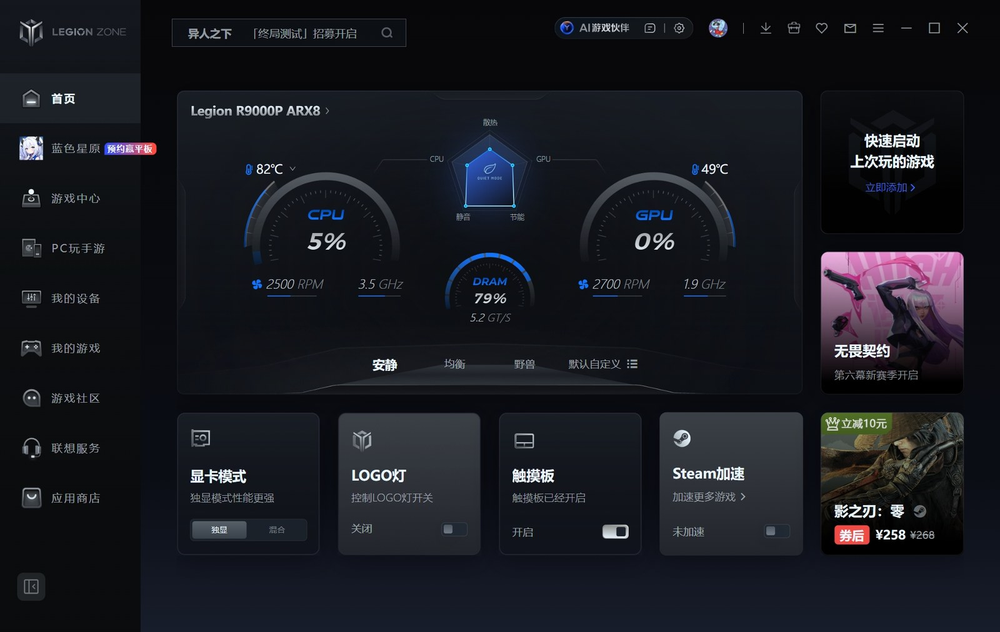
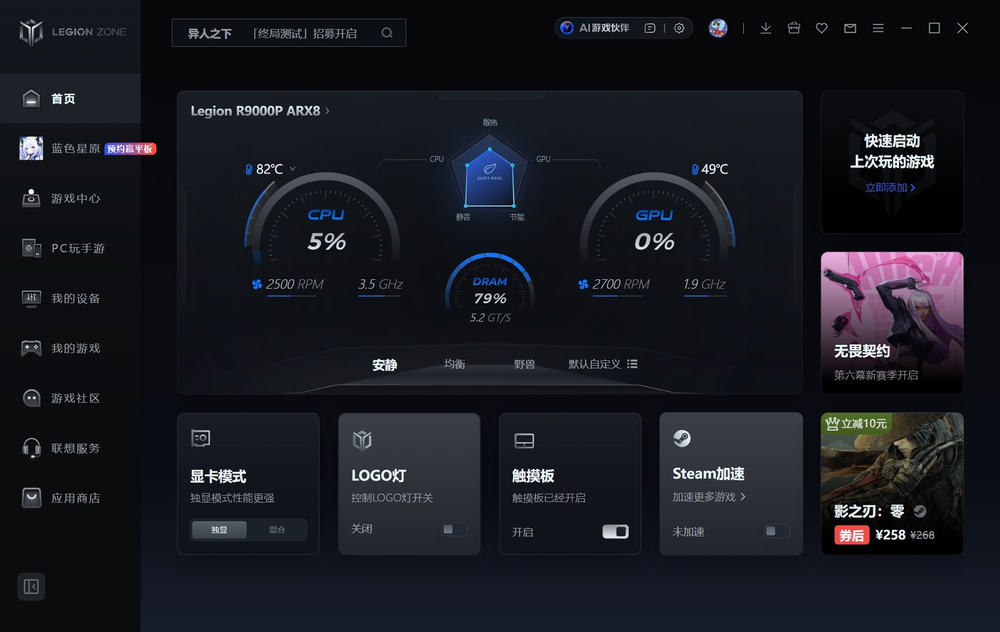

> 本工具通过关闭 Windows 处理器性能提升（Boost）来降低轻载温度。
> **在本项目作者的测试机上（Lenovo Legion R9000P ARX8 / AMD Ryzen 9 7945HX），轻载温度下降约 20–25℃（本次实测 24℃）。**
> 该数字为个人实测，不代表所有设备，详见文末免责声明。

<div align="center">

# BoostGuard

**一键关闭 CPU 加速，让笔记本安静下来**


托盘常驻 · 无需管理员权限 · 退出自动恢复 · 原生系统通知

</div>

---

## 它解决什么问题

很多高性能笔记本（尤其 AMD HX 系列）在**几乎空载**时温度依然停在 80℃ 左右。

原因是 Windows 的「最大处理器状态」**管不住 Boost**：

| 机制 | 作用 |
|---|---|
| 最大处理器状态（`PROCTHROTTLEMAX`） | 只限制 P-state 上限 |
| 处理器性能提升模式（`PERFBOOSTMODE`） | 独立开关，决定 CPU 能否超基频加速 |

即使把最大处理器状态压到 35%，只要 Boost 还开着，CPU 依然会在轻载瞬间冲到 3.6GHz 以上，电压随之抬高到 1.3V+，热点温度自然高。

BoostGuard 直接关掉后者，并把系统散热策略切为「主动」（优先提高风扇转速而不是先降频）。

## 实测数据

测试机：Lenovo Legion R9000P ARX8 · AMD Ryzen 9 7945HX（16C/32T）· Windows 11

| 指标 | 关闭 Boost 前 | 关闭 Boost 后 |
|---|---|---|
| CPU 负载 | 13–17% | 12.5–15.4% |
| `% Processor Performance` | **145%** | **99%** |
| 实际频率 | ≈ 3.6 GHz | ≈ 2.5 GHz（基频） |
| 温度 | **82℃** | **58℃** |

关闭 Boost 后频率落到基频，多核性能损失约 20–30%，但对办公、网页、写代码、开热点这类负载完全无感——32 个线程里通常只有 3–5 个在工作。

## 实测对比

> 测试机：Lenovo Legion R9000P ARX8 · AMD Ryzen 9 7945HX · Windows 11 · 轻载

| 关闭 Boost 前（82℃） | 关闭 Boost 后（58℃） |
|---|---|
|  |  |

## 功能

- 托盘右键一键开关 Boost，双击图标快速切换
- 退出程序（含关机/重启）自动还原原值，不留残留
- 关闭/恢复都弹出 Windows 原生通知
- 单文件 8MB，无运行库依赖，不需要管理员权限
- 开机自启可随时勾选，写 HKCU，不弹 UAC
- 原始值保存在 `state.json`，支持反复开关

## 使用

1. 到 [Releases](../../releases) 下载 `BoostGuard.exe`
2. 放到任意目录（建议固定路径，别放临时目录）
3. 双击运行，托盘出现绿色箭头图标，Boost 立即关闭
4. 右键托盘图标：
   - **恢复 Boost** / **关闭 Boost**：手动切换
   - **开机自启**：勾选后登录自动运行
   - **退出（自动恢复 Boost）**：退出并还原设置

## 卸载

右键托盘 →「退出（自动恢复 Boost）」→ 删除 `BoostGuard.exe`、`state.json`、`boost_guard.log` 即可。程序不会写入注册表以外的任何位置（自启项在 `HKCU\Software\Microsoft\Windows\CurrentVersion\Run`，退出时可在菜单里取消）。

## 从源码构建

```powershell
pip install pyinstaller
pyinstaller --onefile --noconsole --icon boostguard.ico --name BoostGuard src\boost_guard.py
```

没有 ico 也能编译，程序会自动回退到系统图标。也可以直接 `python src\boost_guard.py` 运行。

自检（关闭 → 3 秒 → 恢复，不启动托盘）：

```powershell
python src\boost_guard.py --selftest
```

## 兼容性

| 项目 | 说明 |
|---|---|
| 系统 | Windows 10 / 11 |
| CPU | AMD Zen 2 及以上、Intel 10 代及以上（只要电源方案里有该设置项） |
| 权限 | 普通用户即可，修改的是当前用户自己的电源方案 |
| 多核效果 | 核心越多、默认 Boost 越激进，降幅越明显 |

## 已知限制

- **强杀进程不会恢复设置**：用任务管理器「结束任务」时程序没有机会还原。正常退出、关机、重启都没问题。
- 部分 OEM 电源方案（联想安静模式、华硕 Armoury Crate 等）会覆盖 Windows 的处理器设置，此时降频可能不生效；可先切到「均衡」再试。
- 天气/环境温度、机器是否合盖、风扇曲线都会显著影响结果。**合盖运行是常见的隐藏热源**，进风被挡后 10℃ 以上的差距很常见。
- 若硅脂已老化，软件层面能做的很有限，需要清灰换硅脂（推荐相变片）。

## 免责声明

**降温幅度 20–25℃ 为本项目作者在 Lenovo Legion R9000P ARX8（R9 7945HX）轻载场景下的自测结果，仅代表该配置与环境。**

实际效果取决于 CPU 型号、散热模组、风扇策略、环境温度、是否合盖以及负载类型，可能显著低于该数值，也可能更高。本项目不承诺任何具体降温幅度，不构成性能或散热承诺。

本程序通过 `powercfg` 修改当前用户电源方案中的两项设置，不改动硬件、不安装驱动、不写内核。退出时自动还原。使用本软件即表示你理解并自行承担相关风险；因使用本软件造成的任何直接或间接损失，作者不承担责任。

## License

[MIT](LICENSE)

---

<details>
<summary>English</summary>

**BoostGuard** disables the Windows "Processor performance boost mode" (and sets the thermal policy to *Active*) to cut idle/near-idle temperatures on laptops, then restores your original values when you exit.

On the author's machine (Lenovo Legion R9000P ARX8, Ryzen 9 7945HX) it reduced near-idle temperature by roughly 20–25℃ by keeping the CPU at its 2.5GHz base clock instead of boosting to ~3.6GHz.

- Single 8MB executable, no dependencies, no admin rights required
- Lives in the system tray, restores settings on exit / shutdown
- Native Windows notifications on every toggle
- MIT licensed

The 20–25℃ figure is a single-machine measurement and is **not** a guarantee. Results vary with CPU model, cooling design, fan curve, ambient temperature and whether the lid is closed.

</details>
